  
  
  

  

## Projects

<table>
  <tr>
    <td width="50%" valign="top">
      
      <h3><a href="https://visolab.net">visolab</a></h3>
      A coding website I co-founded where you learn Python and C++ by writing real code in the browser, visualize it, and have it checked by automated test cases.
        
      
    </td>
    <td width="50%" valign="top">
      
      <h3><a href="https://my-app-eosin-kappa-50.vercel.app/">TickTector</a></h3>
      Weekly tick risk for every Massachusetts town, from live state health data and weather forecasts. Built with four teammates at Hackachusetts 2026.
        
      
      
    </td>
  </tr>
</table>

## Research

<table>
  <tr>
    <td width="42%" valign="top">
      
    </td>
    <td valign="top">
      <b><a href="https://openreview.net/forum?id=5s8w8kXDNi">UpstreamQA: A Modular Framework for Explicit Reasoning on Video Question Answering Tasks</a></b>
       
      <b>Jason Nguyen</b>, Ameet Rao, Alexander Chang, Ishaan Kumar, Erin Tan
       
      <i>NeurIPS 2025 Workshop on Vision Language Models</i>
        
      Reasoning models (o4-mini, Gemini 2.5 Pro) identify objects or describe the scene first, then a multimodal model answers the question. This raised Gemini 2.5 Flash's OpenEQA score from 58.8 to 67.8.
        
      
      
    </td>
  </tr>
</table>

## Tools

  

  

## Contributions

<picture>
  <source media="(prefers-color-scheme: dark)" srcset="https://raw.githubusercontent.com/njason2811/njason2811/output/github-snake-dark.svg" />
  <source media="(prefers-color-scheme: light)" srcset="https://raw.githubusercontent.com/njason2811/njason2811/output/github-snake.svg" />
  
</picture>

